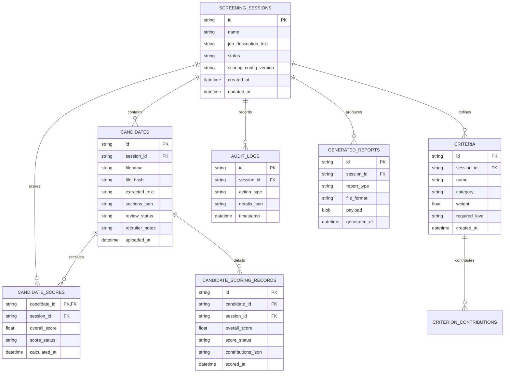

# HireMatch: Database Architecture & Relational Schema

## 1. Storage Overview

HireMatch utilizes an embedded, zero-configuration **SQLite3** relational database (`hirematch.db` in production/runtime, or ephemeral in-memory/temp databases during test runs).

### Database Guarantees
* **Strict Foreign Keys**: Foreign key constraints are enforced on every database connection via `PRAGMA foreign_keys = ON;`.
* **ACID Transactions**: Multi-record operations (e.g., batch candidate scoring or audit trail entries) execute within atomic transactions (`BEGIN IMMEDIATE ... COMMIT`).
* **Connection Pooling**: Managed via `core/storage/database.py` with thread-safe locking and write-ahead logging (WAL) support.

---

## 2. Relational Entity Relationship Diagram



---

## 3. Detailed Table Specifications

### `screening_sessions`
Stores screening sessions and associated job requisitions.
* `id` (`TEXT PRIMARY KEY`): UUIDv4 identifying the session.
* `name` (`TEXT NOT NULL`): Descriptive session title.
* `job_description_text` (`TEXT`): Full text of the target job description.
* `status` (`TEXT NOT NULL`): Current session status (`DRAFT`, `READY`, `PROCESSING`, `COMPLETED`, `ARCHIVED`).
* `scoring_config_version` (`TEXT`): Version tracking for scoring parameter reproducibility (e.g., `v1.0`).
* `created_at` / `updated_at` (`TIMESTAMP`): UTC creation and modification timestamps.

### `candidates`
Stores candidate document metadata, raw extracted text, and review lifecycle states.
* `id` (`TEXT PRIMARY KEY`): UUIDv4 identifying the candidate.
* `session_id` (`TEXT NOT NULL, REFERENCES screening_sessions(id) ON DELETE CASCADE`): Associated session.
* `filename` (`TEXT NOT NULL`): Original filename of the uploaded resume.
* `file_hash` (`TEXT NOT NULL`): SHA-256 checksum used to prevent accidental duplicate enrollments.
* `extracted_text` (`TEXT`): Raw cleansed text extracted from the document.
* `sections_json` (`TEXT`): Serialized JSON structure containing segmented sections (experience, skills, education).
* `review_status` (`TEXT NOT NULL DEFAULT 'IN_REVIEW'`): Human reviewer decision (`IN_REVIEW`, `SHORTLISTED`, `ON_HOLD`, `NOT_SHORTLISTED`).
* `recruiter_notes` (`TEXT`): Optional notes entered by the hiring manager.

### `criteria`
Stores individual evaluation criteria defined for a screening session.
* `id` (`TEXT PRIMARY KEY`): Unique criterion identifier.
* `session_id` (`TEXT NOT NULL, REFERENCES screening_sessions(id) ON DELETE CASCADE`): Owning session.
* `name` (`TEXT NOT NULL`): Criterion name (e.g., "Python Backend", "5+ Years Experience").
* `category` (`TEXT NOT NULL`): Enum value (`TECHNICAL_SKILL`, `SOFT_SKILL`, `WORK_EXPERIENCE`, `EDUCATION`, `CERTIFICATION`).
* `weight` (`REAL NOT NULL DEFAULT 1.0`): User-configured raw importance weight.
* `required_level` (`TEXT`): Required proficiency or tenure threshold.

### `candidate_scores` & `candidate_scoring_records`
* `candidate_scores`: Lightweight summary table for fast sorting and ranking queries.
* `candidate_scoring_records`: Full auditable breakdown containing serialized `contributions_json` (Layer 1 lexical matches, Layer 2 alias hits, Layer 3 cosine similarities, text snippets, and normalized weights).

### `audit_logs`
Immutable compliance and activity record.
* `id` (`TEXT PRIMARY KEY`): Audit entry UUID.
* `session_id` (`TEXT REFERENCES screening_sessions(id) ON DELETE CASCADE`): Associated session.
* `action_type` (`TEXT NOT NULL`): Action code (e.g., `SESSION_CREATED`, `CANDIDATE_STATUS_UPDATED`, `SCORES_CALCULATED`).
* `details_json` (`TEXT`): Contextual payload and user parameters.
* `timestamp` (`TIMESTAMP NOT NULL DEFAULT CURRENT_TIMESTAMP`): Immutable UTC timestamp.

---

## 4. Indexing & Optimization

The database applies targeted single and composite indexes:
* `idx_candidates_session`: Optimizes candidate retrieval for a session (`CREATE INDEX idx_candidates_session ON candidates(session_id);`).
* `idx_candidates_hash`: Accelerates duplicate resume lookups (`CREATE INDEX idx_candidates_hash ON candidates(session_id, file_hash);`).
* `idx_scores_session_rank`: Optimizes leaderboard queries (`CREATE INDEX idx_scores_session_rank ON candidate_scores(session_id, overall_score DESC);`).
* `idx_audit_session_time`: Optimizes audit log retrieval chronologically (`CREATE INDEX idx_audit_session_time ON audit_logs(session_id, timestamp DESC);`).

---

## 5. Backup & Recovery

1. **Hot SQLite Backup**: HireMatch supports online database backups via the SQLite backup API without requiring application downtime:
   ```python
   import sqlite3
   src = sqlite3.connect("hirematch.db")
   dst = sqlite3.connect("hirematch_backup.db")
   src.backup(dst)
   dst.close()
   src.close()
   ```
2. **Schema Migration**: Database schemas are versioned and initialized with idempotent `CREATE TABLE IF NOT EXISTS` directives and schema migration hooks in `core/storage/database.py`.
