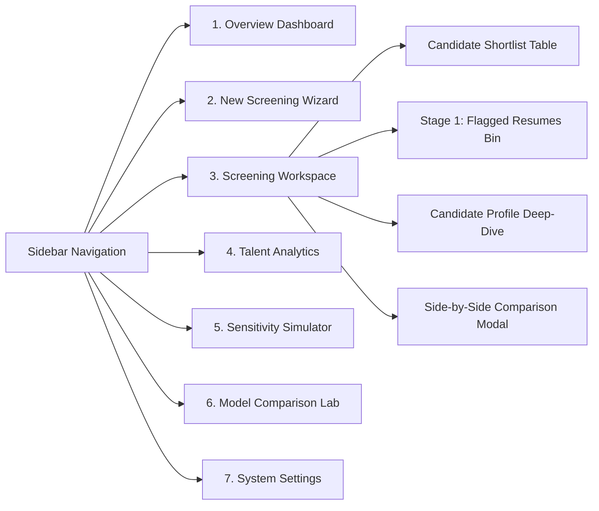

# HireMatch – UI/UX Design System & Visual Identity Specification

**Version:** 1.0.0 (Phase 2)  
**System Name:** *Atlas Design System for Recruitment Intelligence*  
**Design Philosophy:** Sophisticated, Evidence-First, Explainable, Human-Centric.

---

## 1. Product & Design Vision

HireMatch is an **AI-powered recruitment intelligence platform**, not an automated hiring tool. The user interface must reflect this philosophy in every interaction:

1. **Evidence Before Conclusions:** Every score, rating, or match percentage is accompanied by verbatim text excerpts from the candidate's resume.
2. **Cognitive Clarity Over Visual Fluff:** No distracting neon gradients, particle animations, or pseudo-futuristic "AI glowing brains". We use a calm, authoritative palette that recruiters can look at for 8 hours a day without eye fatigue.
3. **High-Density Scalability:** The system accommodates high-volume screening (up to **100 resumes per session**) without screen clutter, UI lag, or visual overwhelm.
4. **Honest Uncertainty & Responsible AI:** Missing information is explicitly labeled as `Unspecified` or `No Documented Evidence`, never penalized as incompetence or negative evidence.

---

## 2. Visual Identity & Design Tokens

### 2.1 Color Palette & Token Architecture

The palette is anchored on deep executive slates and navy neutrals, balanced by an intentional, high-contrast **Electric Indigo / Cobalt** accent for key interactive elements, and accessible semantic status colors.

```
┌────────────────────────────────────────────────────────────────────────┐
│                        PRIMARY FOUNDATION                              │
│  [ #0B0F19 ]   [ #111827 ]   [ #1F2937 ]   [ #374151 ]   [ #4F46E5 ]   │
│   Canvas        Surface 1     Surface 2     Border       Accent Brand  │
└────────────────────────────────────────────────────────────────────────┘
```

#### A. Core Brand & Surfaces
| Token Name | Hex Code | Purpose & Usage |
| :--- | :--- | :--- |
| `--color-canvas-bg` | `#0B0F19` | Main application background (deep nocturnal slate). |
| `--color-surface-card` | `#111827` | Standard card and container background. |
| `--color-surface-hover` | `#1F2937` | Hovered card state, dropdown item hover. |
| `--color-surface-active` | `#374151` | Selected tabs, active pills, table header backgrounds. |
| `--color-border-subtle` | `#1F2937` | Subtle inner borders, list dividers. |
| `--color-border-default` | `#374151` | Standard card borders, input borders. |
| `--color-border-focus` | `#6366F1` | Active focus rings, highlighted table rows. |

#### B. Brand Accent (Electric Indigo / Sapphire)
| Token Name | Hex Code | Purpose & Usage |
| :--- | :--- | :--- |
| `--color-accent-primary` | `#4F46E5` | Primary action buttons, primary progress fills, brand accents. |
| `--color-accent-hover` | `#4338CA` | Hover state for primary buttons. |
| `--color-accent-subtle` | `rgba(79, 70, 229, 0.12)` | Subtle badge backgrounds, selection highlights. |
| `--color-accent-contrast`| `#FFFFFF` | Text on accent buttons. |

#### C. Neutral Typography Scale
| Token Name | Hex Code | Contrast on Surface | Purpose |
| :--- | :--- | :--- | :--- |
| `--color-text-primary` | `#F9FAFB` | 14.8:1 (AAA) | Page titles, primary metrics, candidate names. |
| `--color-text-secondary` | `#E5E7EB` | 12.1:1 (AAA) | Body copy, table cells, form labels. |
| `--color-text-muted` | `#9CA3AF` | 7.2:1 (AAA) | Timestamps, metadata, file sizes, captions. |
| `--color-text-disabled` | `#4B5563` | 4.6:1 (AA) | Disabled controls, unavailable data placeholders. |

#### D. Semantic Status Palette
Every status color has an explicit 4.5:1+ contrast ratio against dark surfaces, and is paired with iconography for accessibility:

| Status Role | Base Hex | Subtle Fill (12% opacity) | Icon | Meaning |
| :--- | :--- | :--- | :--- | :--- |
| **Pass / Success** | `#10B981` | `rgba(16, 185, 129, 0.12)` | `✓` | Quality passed, strong match, completed. |
| **Review / Warning** | `#F59E0B` | `rgba(245, 158, 11, 0.12)` | `⚠️` | Quality flagged, partial match, needs attention. |
| **Fail / Critical** | `#EF4444` | `rgba(239, 68, 68, 0.12)` | `✕` | Validation error, missing required skill, corrupt file. |
| **Duplicate** | `#8B5CF6` | `rgba(139, 92, 246, 0.12)` | `⧉` | Duplicate resume hash detected. |
| **Info / Neutral** | `#3B82F6` | `rgba(59, 130, 246, 0.12)` | `ℹ` | Pending processing, informational note. |

---

### 2.2 Typography Scale

HireMatch uses a clean geometric sans-serif stack:  
`font-family: -apple-system, BlinkMacSystemFont, "Segoe UI", Roboto, "Inter", "Helvetica Neue", Arial, sans-serif;`  
For code, hashes, and evidence offsets:  
`font-family: "JetBrains Mono", "SF Mono", "Consolas", Menlo, monospace;`

| Role | Size | Line Height | Weight | Tracking |
| :--- | :--- | :--- | :--- | :--- |
| **Display H1** | `28px` (1.75rem) | `36px` | 700 (Bold) | -0.02em |
| **Section H2** | `22px` (1.375rem)| `28px` | 600 (SemiBold) | -0.01em |
| **Subhead H3** | `18px` (1.125rem)| `24px` | 600 (SemiBold) | 0.0em |
| **Card Title H4**| `15px` (0.938rem)| `20px` | 600 (SemiBold) | 0.0em |
| **Body Default** | `14px` (0.875rem)| `20px` | 400 (Regular) | 0.0em |
| **Body Medium**  | `14px` (0.875rem)| `20px` | 500 (Medium) | 0.0em |
| **Caption/Meta** | `12px` (0.75rem) | `16px` | 400 (Regular) | +0.01em |
| **Monospace**    | `12px` (0.75rem) | `16px` | 500 (Medium) | 0.0em |

---

### 2.3 Spacing, Radii & Elevation

- **Modular Spacing (8pt Base Grid):**
  - `space-1` = `4px` (micro spacing, badge padding)
  - `space-2` = `8px` (compact spacing, button internal gaps)
  - `space-3` = `12px` (standard input padding, card internal spacing)
  - `space-4` = `16px` (card padding, grid gaps)
  - `space-6` = `24px` (section separators, modal padding)
  - `space-8` = `32px` (major page block offsets)

- **Border Radii:**
  - `radius-sm` = `4px` (tags, badges, tiny controls)
  - `radius-md` = `8px` (buttons, inputs, dropdowns)
  - `radius-lg` = `12px` (cards, modal containers, data tables)
  - `radius-full` = `9999px` (circular avatar pills, status indicators)

- **Elevation & Shadows:**
  - `elevation-0`: Flat surface with border (`1px solid #1F2937`)
  - `elevation-1`: Subtle card float (`box-shadow: 0 1px 3px rgba(0, 0, 0, 0.3)`)
  - `elevation-2`: Modal / dropdown hover (`box-shadow: 0 4px 12px rgba(0, 0, 0, 0.45)`)

---

## 3. Information Architecture & Navigation

The navigation is structured around the recruiter's natural mental model:



### 3.1 Overview Dashboard
- **Top Row (Metrics Bar):** Active Jobs, Total Sessions, Resumes Evaluated, Quality Pass Rate (%).
- **Primary Section:** Recent Screening Sessions table with live status badges (`Processing 42/100`, `Completed`, `Created`).
- **Quick Action:** Prominent "Start New Screening" button.
- **Empty State:** High-context onboarding card with a 3-step walkthrough and sample dataset loader.

### 3.2 New Screening Wizard (7-Step Guided Flow)
1. **Target Job:** Select existing job posting or create a new one.
2. **Job Description Input:** Paste text or upload JD document.
3. **Requirement Extraction:** Auto-parsed skills, min experience, education criteria (with recruiter edit controls).
4. **Resume Ingestion:** Drag-and-drop up to **100 resumes** with live capacity meter.
5. **Pre-flight Validation & Duplicate Audit:** Instant SHA-256 duplicate flag review and file size check.
6. **Scoring Configuration:** Review default weights (Skills: 35%, Exp: 30%, Edu: 10%, Domain: 15%, Competency: 10%).
7. **Session Launch:** Review summary and trigger background parsing.

### 3.3 Screening Workspace
- **Header:** Job Title, Session Name, Status chip, Date created.
- **Top Tab Switcher:**
  - **Tab A: Approved Shortlist (Passed Quality Gate):** Ranked candidates with composite score, matched skills badges, and CTC/Location status chips.
  - **Tab B: Quality Review Bin (Flagged Resumes):** Resumes with scores below the Quality Threshold, displaying specific diagnostics (e.g. *Missing Experience Section*, *Unparseable Text*), with a manual "Force Admit" override switch.
- **Filtering & Sort Toolbar:** Search by candidate name/keyword, filter by Min Score, Experience Range, Location Match, and CTC Budget status.

### 3.4 Candidate Profile Deep-Dive
- **Candidate Hero:** Name, original filename, Overall Score gauge, Quality Score chip, CTC and Location chips.
- **Score Breakdown Panel:** Horizontal progress bars for each criterion with exact weight, calculated score, and status.
- **Evidence Inspector (Crucial Feature):**
  - Clicking any criterion opens the **Verbatim Evidence Card**, quoting the exact sentence/paragraph extracted from the resume and the page/line offset.
- **Skills Matrix:** Side-by-side chips: `Exact Matches`, `Semantic Matches (Equivalent)`, and `Missing Required`.
- **Extraction Warnings & Quality Log:** Lists any anomalies (e.g., overlapping dates, missing GPA, OCR artifacts).

### 3.5 Candidate Comparison Matrix
- Side-by-side columns for 2 to 4 candidates.
- Synchronized rows: Overall Score, Technical Skills Match, Years of Relevant Experience, Education & Certs, Domain Relevance, Behavioral Evidence, CTC Expectation, Location.
- Visual delta highlighting: Highlights higher qualification in subtle green tint.

### 3.6 Analytics & Model Laboratory
- **Talent Pool Skill Gap:** Bar chart showing required skills ordered by coverage percentage across all 100 applicants.
- **Experience Distribution:** Histogram showing seniority profile of the applicant pool.
- **Model Comparison:** Comparison table of Keyword (TF-IDF) vs. Semantic (MiniLM) rank positions.

---

## 4. The 100-Resume Upload Experience

Uploading up to 100 resumes can easily freeze a web page or flood the viewport if poorly designed. Here is our high-performance UI architecture:

```
┌────────────────────────────────────────────────────────────────────────┐
│  UPLOAD RESUMES                                                        │
│  [  Drag & Drop up to 100 PDF or DOCX files here  ]                    │
│                                                                        │
│  Capacity: [████████████████████░░░░░░░░░░] 68 / 100 Resumes (32 left) │
│                                                                        │
│  Batch Summary:                                                        │
│  ● 65 Valid Files    ● 2 Duplicates Flagged    ● 1 Corrupted / Invalid │
├────────────────────────────────────────────────────────────────────────┤
│  FILES READY FOR ENROLLMENT (68)                       [ Filter ▼ ]    │
│                                                                        │
│  1. Sarah_Jenkins_Senior_Dev.pdf    (1.2 MB)   [✓ Valid]        [✕]    │
│  2. David_Chen_Resume.docx          (420 KB)   [✓ Valid]        [✕]    │
│  3. Alex_Smith_CV_Copy.pdf          (1.2 MB)   [⧉ Duplicate]    [✕]    │
│  4. Damaged_File_Scan.pdf           (8.4 MB)   [⚠️ Corrupt PDF] [✕]    │
│                                                                        │
│  Displaying 1–10 of 68 files                  [< Prev]  Page 1  [Next >]│
└────────────────────────────────────────────────────────────────────────┘
```

### 4.1 Key Upload UX Components
1. **Interactive Capacity Gauge:**
   - Visual segmented progress bar displaying `N / 100 Resumes Enrolled`.
   - Color shifts: Green ($1–80$), Amber ($81–99$), Red ($100$ - "Session Full").
   - Explicitly blocks selection if adding the batch would exceed 100.
2. **Pre-flight Diagnostic Badges:**
   - As files are selected, client-side/pre-flight checks immediately display:
     - `Valid` (Green check)
     - `Duplicate Content` (Purple hash icon with tooltip explaining file hash collision)
     - `Unsupported Type` (Red cross)
     - `Oversized (>10MB)` (Amber warning)
3. **Paginated & Grouped File Drawer:**
   - Avoids a 100-item vertical scrolling nightmare by showing 10 items per page with instant search.
   - Quick toggle filters: `All (68)`, `Valid (65)`, `Needs Attention (3)`.
   - Single-click "Remove Invalid / Duplicates" button to clean up the batch in one stroke.

---

## 5. Processing & Progress Experience

When processing begins, recruiters need transparent, real-time feedback without misleading animated loaders:

```
┌────────────────────────────────────────────────────────────────────────┐
│  PROCESSING SESSION: "Full Stack Screening - Batch Oct 2026"          │
│  Status: EXTRACTING & EVALUATING                                       │
│                                                                        │
│  Progress: [██████████████████████████░░░░░░░░] 64% Complete           │
│                                                                        │
│  [  64 Processed  ]  [  32 Queued  ]  [  3 Flagged  ]  [  1 Failed  ] │
│                                                                        │
│  Current Operation: Evaluating candidate 65 / 100: "Marcus_Vance.pdf"  │
│  Est. Remaining Time: ~25 seconds                                      │
└────────────────────────────────────────────────────────────────────────┘
```

- **True State Binding:** Progress is linked directly to the database `session_candidates` table count (`processed / total * 100`).
- **Resilient Recovery:** If a file fails parsing (e.g. password-protected PDF), it logs the failure in the `Failed` chip without crashing the remaining 99 candidates.
- **Stage Progression:** Clearly displays which pipeline step is running: `1. Ingestion` $\to$ `2. Quality Check` $\to$ `3. Text Extraction` $\to$ `4. Criteria Evaluation`.

---

## 6. Candidate Score & Evidence Visualization

### 6.1 Score Presentation Philosophy
- **Never claim certainty:** We use **"Match Index (0–100)"** or **"Suitability Score"**, never "Probability of Hire" or "Success Chance".
- **Weight Transparency:** Every score item shows its configured weight (e.g. `Technical Skills (Weight: 35%) → Score: 88/100 → Contributes 30.8 pts`).
- **Separation of Operational Constraints:**
  - CTC and Location are shown as **Operational Flags** (`Within Budget`, `Relocation Needed`), never blended into the competency score to avoid unfairly penalizing qualified candidates.

### 6.2 The Verbatim Evidence Card
When a recruiter clicks on a score or matched skill, an Evidence Card displays:

```
┌────────────────────────────────────────────────────────────────────────┐
│  EVIDENCE CITATION: Python & Distributed Systems Match                 │
│  Criterion: Technical & Functional Skills (Required)                   │
├────────────────────────────────────────────────────────────────────────┤
│  Matched Skill: Python (Exact Match)                                   │
│  Confidence: 100%                                                      │
│                                                                        │
│  "Spearheaded the redesign of our core microservices from Ruby to      │
│   Python (FastAPI), reducing 99th-percentile API response latency by   │
│   45% across 12 million daily active users."                           │
│                                                                        │
│  Source: Work Experience — Senior Backend Engineer at FinCorp          │
│  Dates Documented: March 2021 – Present                                │
└────────────────────────────────────────────────────────────────────────┘
```

---

## 7. Streamlit Implementation Strategy

To implement this design system in Streamlit without fragile DOM hacks or breaking Streamlit updates:

1. **Global CSS Injection (`ui/styles.py`):**
   - Inject clean, targeted CSS variables (`--color-canvas-bg`, etc.) via `st.markdown(..., unsafe_allow_html=True)`.
   - Style native Streamlit elements (`st.metric`, `st.button`, `st.expander`, `st.dataframe`) cleanly.
2. **Custom HTML Component Renderers:**
   - Reusable Python functions for:
     - `render_badge(text, status)`
     - `render_capacity_meter(current, max_limit)`
     - `render_candidate_card(candidate, score, evidence_count)`
     - `render_evidence_quote(text, source, match_type)`
3. **Plotly Chart Theming:**
   - A centralized Plotly theme helper `get_hirematch_chart_theme()` setting background to `#111827`, gridlines to `#1F2937`, text to `#E5E7EB`, and accent palettes matching our tokens.

---

## 8. Responsible AI Presentation Guidelines

1. **No Psychological Inference:** The system will never attempt to infer "Personality", "Emotional Stability", "Introversion/Extroversion", or "Cultural Fit" from text formatting.
2. **Missing Information $\neq$ Negative Evidence:** If a resume omits certifications or GPA, the UI labels it as `Not Documented`, not `Deficient`.
3. **Audit Trail for Overrides:** Any manual change by a recruiter (e.g., overriding a Quality Gate flag or boosting a score) is visually badged as `Recruiter Override` with the recruiter's rationale.
