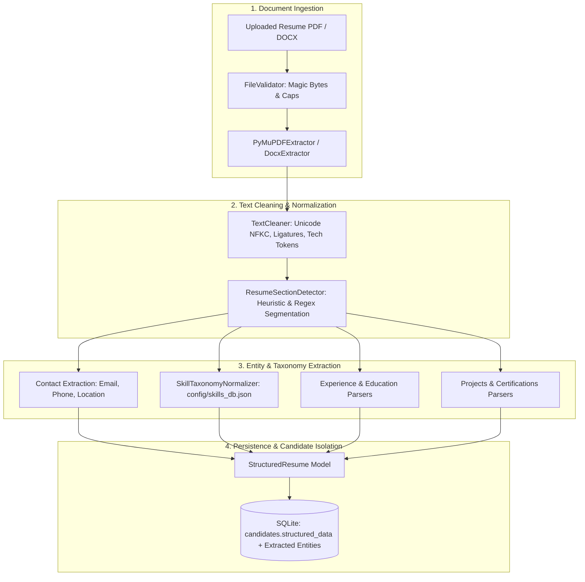

# Phase 4: Document and Job Description Processing Engine

## 1. Overview & Architecture

Phase 4 introduces the structured extraction and normalization foundation for **HireMatch**. Before any candidate scoring or semantic evaluation occurs, raw resumes (PDF/DOCX) and Job Descriptions (JD) are transformed into clean, validated, normalized domain objects with end-to-end evidence traceability.



---

## 2. Core Components

### 2.1 Text Cleaning (`core/processing/cleaner.py`)
- **Unicode NFKC Normalization**: Resolves multi-byte character inconsistencies across word processors.
- **Ligature Disambiguation**: Decomposes typographical ligatures (`fi` $\to$ `fi`, `fl` $\to$ `fl`, `ff` $\to$ `ff`, `ffi` $\to$ `ffi`, `ffl` $\to$ `ffl`).
- **Whitespace & Control Character Compaction**: Strips terminal control characters while preserving paragraph breaks.
- **Technical Token Preservation**: Protects symbols like `C++`, `C#`, `.NET`, `Node.js`, and `CI/CD` from regex boundary erosion.

### 2.2 Document Extraction & Scanned Detection (`core/processing/extractor.py`)
- **`PyMuPDFExtractor`**: Performs page-by-page PDF stream extraction. Emits structured `PageText` records with character counts.
- **Scanned / Image PDF Detection**: Flags documents with `< 30` characters across pages as `ocr_needed = True` and quarantines them under `FLAGGED_QUALITY` rather than hallucinating text.
- **`DocxExtractor`**: High-performance extraction of paragraphs and nested table cell text (`|` delimited), preserving document ordering. Includes native standard-library XML extraction fallback.

### 2.3 Section Segmentation (`core/processing/section_detector.py`)
- Heuristically detects standard headings (`SUMMARY`, `SKILLS`, `EXPERIENCE`, `EDUCATION`, `PROJECTS`, `CERTIFICATIONS`, `PUBLICATIONS`, `LANGUAGES`, `HEADER`, `UNCLASSIFIED`).
- Strips bullet points, numbering, and colons while maintaining confidence scores.

### 2.4 Skill Taxonomy Normalizer (`core/processing/skill_normalizer.py`)
- Curated database: `config/skills_db.json` spanning **6 major technical categories** and 160+ alias mappings.
- Maps acronyms and common variations (e.g., `K8s` $\to$ `Kubernetes`, `ReactJS` $\to$ `React`, `psql` $\to$ `PostgreSQL`, `TS` $\to$ `TypeScript`).
- Sentence-level evidence extraction: every extracted skill captures the verbatim sentence in which it appeared.

### 2.5 Structured Resume Parser (`core/processing/resume_parser.py`)
Produces a typed `StructuredResume` object:
- **`contact`**: Extracted strictly for operational communication (email, phone, location) and quarantined from suitability scoring.
- **`skills`**: Normalized skills mapped to taxonomy categories with verbatim evidence sentences.
- **`experience`**: Structured work history entries (`job_title`, `employer`, `dates`, `extracted_description`, `evidence_text`).
- **`education`**: Structured education records (`degree`, `institution`, `dates`, `field_of_study`).
- **`certifications` & `projects`**: Extracted credential and portfolio items.

### 2.6 Enhanced Job Description Parser (`core/processing/jd_parser.py`)
Produces a typed `StructuredJobDescription` object:
- Detects job title and categorizes bulleted lines into **Mandatory Requirements** vs. **Preferred Qualifications**.
- Automatically extracts required minimum experience in years (e.g. `5+ years`).
- Identifies minimum required degree level (`Bachelor's Degree`, `Master's Degree`, `PhD`).
- Extracts technical skills required vs. preferred via taxonomy.

---

## 3. Database Schema & Migration

In `core/storage/database.py`, the `candidates` table is automatically migrated:
```sql
ALTER TABLE candidates ADD COLUMN structured_data TEXT DEFAULT '{}';
```

Stored JSON representation:
```json
{
  "contact": {
    "name": "Jane Smith",
    "email": "jane.smith@example.com",
    "phone": "+1 415-555-0142",
    "location": "San Francisco, CA"
  },
  "skills": [
    {
      "skill_name": "Kubernetes",
      "normalized_skill_name": "Kubernetes",
      "evidence_text": "Architected Kubernetes clusters across AWS and GCP.",
      "source_location": "EXPERIENCE",
      "confidence": 1.0
    }
  ],
  "experience": [
    {
      "job_title": "Lead DevOps Architect",
      "employer": "TechGlobal Corp",
      "dates": "2021 - Present",
      "extracted_description": "Managed cloud migrations...",
      "evidence_text": "Lead DevOps Architect TechGlobal Corp 2021 - Present"
    }
  ],
  "education": [
    {
      "degree": "Bachelor of Science in Computer Science",
      "institution": "University of California, Berkeley",
      "dates": "2015 - 2019"
    }
  ]
}
```

---

## 4. Operational Controls & Failure Resilience

1. **Failure Isolation**: A malformed or corrupted document fails independently without terminating the batch processing of other resumes in the session.
2. **Retry Mechanism**: The Screening Workspace includes a **🔄 Retry Failed** action that resets failed resumes to `PENDING`, allowing the recruiter to retry extraction after correcting configuration or file issues.
3. **Quarantine of Operational Metadata**: Candidate contact details (email, phone, address) are separated into operational tabs and explicitly isolated from suitability evaluation algorithms in future phases.

---

## 5. Verification & Testing

The Phase 4 test suite is located in `tests/test_document_processing.py` and runs alongside the complete HireMatch test suite:

```bash
python -m unittest discover tests -v
```

Total passing tests: **47 unit tests across 6 suites** with zero failures in under 4.5 seconds.
