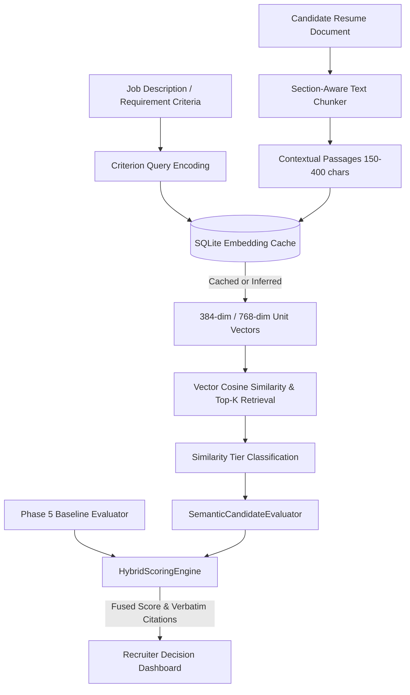

# HireMatch – Pretrained Semantic AI Matching Engine (Phase 6)

## 1. Overview & Architecture

HireMatch Phase 6 extends the recruitment intelligence platform with a **pretrained semantic matching engine**. While the Phase 5 baseline engine evaluated exact keywords, phrase aliases, and structured requirements, Phase 6 introduces dense sentence embeddings and vector cosine similarity to understand conceptual relevance, synonyms, and paraphrased resume achievements.

Crucially, HireMatch **never trains an LLM or neural model from scratch**. It leverages established, open-weights sentence transformer architectures optimized for high-throughput CPU/GPU inference.



---

## 2. Pretrained Model Catalog

| Model ID | Architecture | Dimensions | Max Tokens | Size | Primary Use Case |
| :--- | :--- | :--- | :--- | :--- | :--- |
| `sentence-transformers/all-MiniLM-L6-v2` | MiniLM (6-layer) | 384 | 256 | ~80 MB | **Default** high-throughput screening for up to 100 resumes per session. Fast CPU execution (~5ms/passage). |
| `sentence-transformers/all-mpnet-base-v2` | MPNet (12-layer) | 768 | 384 | ~420 MB | Nuanced conceptual matching, complex domain terminology. |
| `BAAI/bge-small-en-v1.5` | BERT-small | 384 | 512 | ~130 MB | Dense passage retrieval optimized for search queries and requirements. |
| `cross-encoder/ms-marco-MiniLM-L-6-v2` | Cross-Encoder | N/A (Score) | 512 | ~80 MB | Optional stage-2 neural reranker for scoring query-passage pairs directly. |

### Provider Resilience & Hermetic Testing
To ensure the application runs reliably across different development, testing, and production environments:
1. **`SentenceTransformerProvider`**: Loads the HuggingFace transformer model when `sentence-transformers` and `torch` are installed. If missing or network is offline, transitions to `ModelStatus.UNAVAILABLE` with clear diagnostic logs.
2. **`MockEmbeddingProvider`**: Deterministic 384-dimensional vector projection using n-gram token hashing and unit L2 normalization. Ensures identical texts yield cosine similarity $= 1.0$, shared keywords yield high similarity, and hermetic unit tests execute in seconds without torch or internet access.
3. **`CachedEmbeddingProvider`**: Transparent decorator wrapping any provider with SQLite persistent caching.

---

## 3. Persistent Binary Vector Caching

In high-volume recruitment screening (up to 100 resumes per session with multiple evaluation criteria), recomputing embedding vectors across criteria queries and repeat candidate evaluations creates unnecessary latency and CPU waste.

HireMatch stores vector embeddings in a dedicated SQLite table:

```sql
CREATE TABLE IF NOT EXISTS embedding_cache (
    cache_key TEXT PRIMARY KEY,
    model_name TEXT NOT NULL,
    text_content TEXT NOT NULL,
    embedding_blob BLOB NOT NULL,
    dimension INTEGER NOT NULL,
    created_at TEXT NOT NULL
);
CREATE INDEX IF NOT EXISTS idx_embedding_cache_model ON embedding_cache(model_name);
```

- **Cache Key**: Deterministic SHA-256 hash: `sha256(f"{model_name}:{normalized_text}")`.
- **Serialization**: Raw IEEE 754 32-bit floats converted via `numpy.ndarray.tobytes()`, unpacked via `numpy.frombuffer(blob, dtype=np.float32)` in microseconds.
- **Batch Querying**: `get_batch()` checks existing keys in SQLite in batches of 500, inferring only the missing passages.

---

## 4. Section-Aware Text Chunking

Resumes are heterogeneous documents divided into functional sections (Summary, Experience, Skills, Education, Projects). Naive fixed-window character chunking truncates words, splits sentences, and severs contextual meaning.

`SectionAwareTextChunker` solves this:
1. **Section Provenance**: Utilizes extracted section boundaries from Phase 4 structured parsing (`EXPERIENCE`, `SKILLS`, `EDUCATION`, `PROJECTS`), falling back to regex header detection on raw text.
2. **Sentence Integrity**: Splits on sentence endings and bullet point boundaries (`.`, `!`, `?`, `\n`, `•`).
3. **Bounded Context**: Targets 150–400 characters per passage with 1-sentence overlap between adjacent chunks to maintain local context.
4. **Traceability**: Each chunk retains `text`, `source_section`, `chunk_index`, and character offsets (`char_start`, `char_end`).

---

## 5. Similarity Tiers & Score Calibration

Raw cosine similarities in sentence transformer embedding spaces rarely reach 1.0 for non-identical text. To ensure actionable, interpretable ratings for recruiters, HireMatch maps continuous cosine similarity scores into calibrated qualitative tiers:

| Cosine Similarity | Qualitative Tier | Calibrated Score Range | Match Status | Description |
| :--- | :--- | :--- | :--- | :--- |
| **$\ge 0.70$** | `STRONG` | 85.0 – 100.0 | `SUPPORTED` | Clear, direct contextual alignment with job requirement. |
| **$0.50 - 0.69$** | `POSSIBLE` | 60.0 – 84.9 | `PARTIALLY_SUPPORTED` | Related technical skill, adjacent domain, or partial evidence. |
| **$0.35 - 0.49$** | `WEAK` | 30.0 – 59.9 | `INSUFFICIENT_EVIDENCE` | Distant topical connection, tangential mention. |
| **$< 0.35$** | `INSUFFICIENT` | 0.0 | `NOT_FOUND` | No meaningful semantic evidence in resume. |

---

## 6. Hybrid Multi-Layer Scoring

HireMatch supports three explicit evaluation modes:

1. **`BASELINE`**: Phase 5 rule-based keyword, alias, experience, and education matching. Transparent reference baseline.
2. **`SEMANTIC`**: Phase 6 dense vector embedding retrieval across section-aware passages.
3. **`COMBINED`**: Hybrid fusion balancing keyword precision with semantic contextual recall.

### Fusion Formula
For each evaluation criterion $c$:
$$S_{\text{combined}}(c) = \alpha \cdot S_{\text{baseline}}(c) + (1 - \alpha) \cdot S_{\text{semantic}}(c)$$
*(Default baseline weight $\alpha = 0.5$, configurable)*

The overall candidate score is the criterion-weighted average:
$$\text{Overall Score} = \frac{\sum_{c} w_c \cdot S_{\text{combined}}(c)}{\sum_{c} w_c}$$

### Traceability & Dual Scores
Every evaluated candidate score stores:
- `overall_score`: Final index $(0.0 - 100.0)$.
- `baseline_score`: Standalone Phase 5 score.
- `semantic_score`: Standalone Phase 6 semantic score.
- `combined_score`: Fused hybrid score.
- `evaluation_mode`: Mode used (`BASELINE`, `SEMANTIC`, `COMBINED`).
- `semantic_model`: Embedding model identifier.
- `evidence_coverage`: Percentage of criteria with verified citations.
- `required_supported`: Boolean flag indicating if all mandatory criteria are met.
- `required_unmet_count` & `required_unmet_names`: Explicit list of unverified requirements.

---

## 7. Responsible AI & Recruiter Empowerment

HireMatch follows strict ethical recruitment AI principles:
1. **Textual Evidence $\ne$ Proof of Competence**: High vector similarity indicates textual relevance in the resume, not guaranteed real-world competence.
2. **Absence $\ne$ Negative Proof**: Missing qualifications are categorized as `NOT_FOUND` or `INSUFFICIENT_EVIDENCE`, never penalized with negative scores. Recruiters are prompted to clarify unlisted items directly with the candidate.
3. **Verbatim Traceability**: Every score is accompanied by exact excerpts, section provenance, and similarity metrics. No black-box scores.
4. **Recruiter in Control**: The recruiter retains final hiring authority, with tools to inspect evidence, adjust weights, switch evaluation modes, and simulate thresholds.
