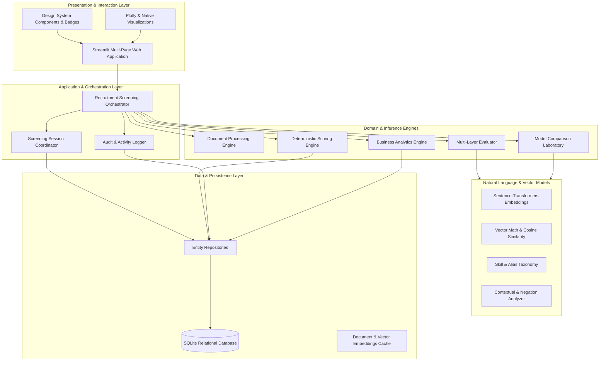

# HireMatch: System Architecture & Subsystem Specification

## 1. Architectural Philosophy

HireMatch follows a modular, layered clean architecture designed around separation of concerns, deterministic reproducibility, and auditable evidence provenance.

The design decouples data ingestion, document processing, semantic inference, mathematical scoring, persistent storage, and visualization into isolated, independently testable boundaries.

---

## 2. Core Subsystems

### 2.1 Presentation Layer (`ui/`)
* **Framework**: Streamlit with custom CSS design system.
* **Pages**:
  * `01_Upload_and_Extraction.py`: Ingestion, validation, text preview, section inspection.
  * `02_Criteria_and_Weights.py`: Criterion definition, category tagging, weight allocation.
  * `03_Screening_Session.py`: Session creation, candidate enrollment, execution trigger.
  * `04_Candidate_Evaluation.py`: Candidate deep-dive, layer-by-layer evidence cards, citations.
  * `05_Comparison_and_Benchmarking.py`: Side-by-side candidate comparison, interactive weight sensitivity sandbox.
  * `06_Business_Analytics.py`: Recruiter pipeline funnel, skill coverage, criterion distribution, audit logs.
  * `07_Model_Laboratory.py`: Benchmarking pretrained sentence encoders, speed/memory telemetry.

### 2.2 Orchestration Layer (`core/orchestrator.py`)
Serves as the single unified application gateway:
* Manages session transactions and coordinate cross-service operations.
* Enforces data validation and consistency across repositories.
* Provides non-mutating simulation methods (`simulate_ranking_sensitivity`) for real-time recruiter exploration without corrupting stored baseline scores.

### 2.3 Document Processing Engine (`core/document_processing/`)
* **Extractors**: PyMuPDF (`fitz`) for PDF documents; `python-docx` for Word DOCX files; native UTF-8 text parser.
* **Security & Validation**: Magic byte signature checks, file size boundaries (10 MB limit), corrupted structure detection.
* **Section Segmentation**: Regex and heading analysis detecting `WORK_EXPERIENCE`, `SKILLS`, `EDUCATION`, `PROJECTS`, `CERTIFICATIONS`.

### 2.4 Multi-Layer Evidence Evaluator (`core/evaluation/`)
Coordinates three distinct evaluation layers for every requirement:
1. **Layer 1: Exact Lexical Match**: Normalized keyword presence in target sections.
2. **Layer 2: Skill Taxonomy & Alias Match**: Maps canonical entities through `skills_db.json` (e.g., "PostgreSQL" ↔ "Postgres").
3. **Layer 3: Dense Semantic Vector Match**: Sentence-level cosine similarity using calibrated thresholds with contextual discount factors.

### 2.5 Deterministic Scoring Engine (`core/scoring/`)
* Guarantees mathematical transparency:
  $$\text{Overall Score} = \sum_{i=1}^n w_i \times s_i$$
* Computes normalized contributions per criterion.
* Enforces explicit status transitions (`IN_REVIEW`, `SHORTLISTED`, `ON_HOLD`, `NOT_SHORTLISTED`, `FLAGGED`).

### 2.6 Persistence Layer (`core/storage/`)
* SQLite relational database with strict foreign key constraints (`PRAGMA foreign_keys = ON`).
* Repository pattern abstracting SQL operations into domain models.
* Atomic multi-row transaction handling for batch scoring records and audit trails.
